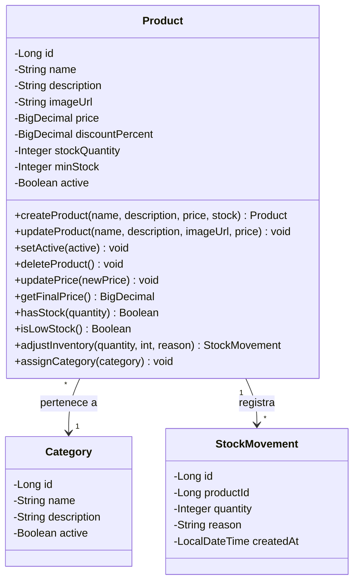
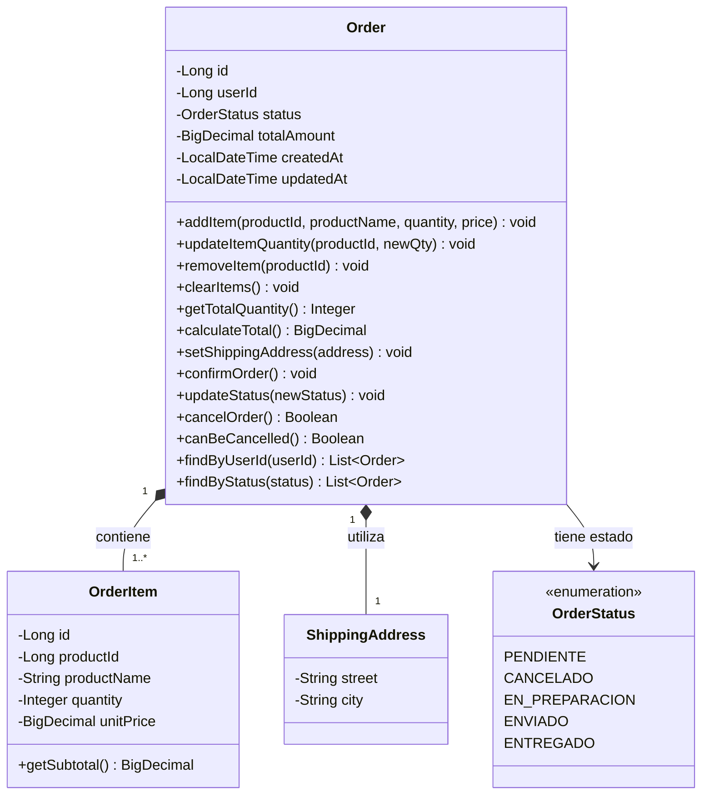
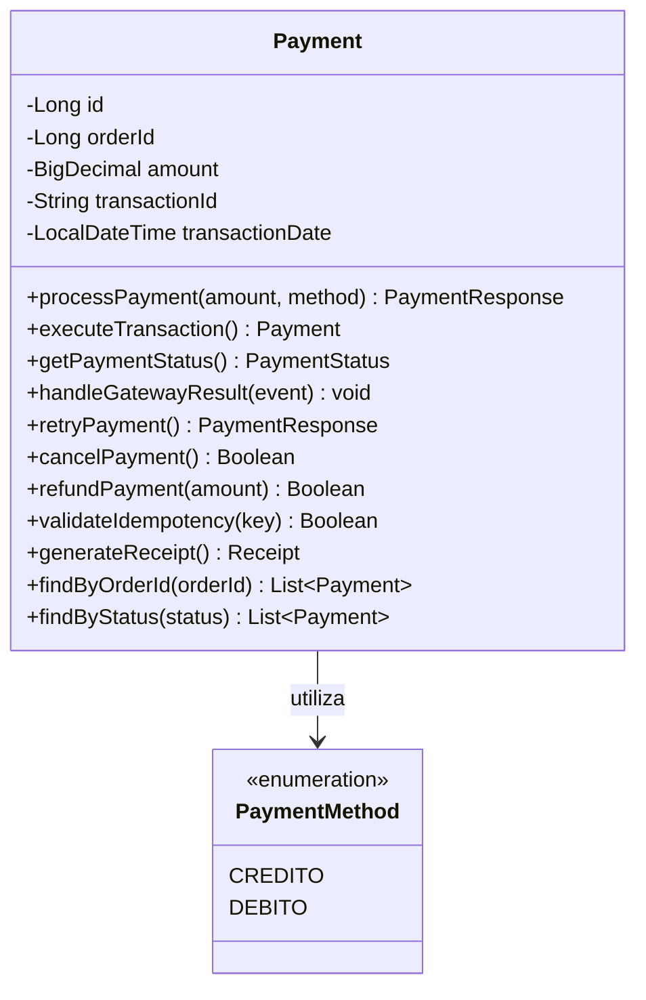
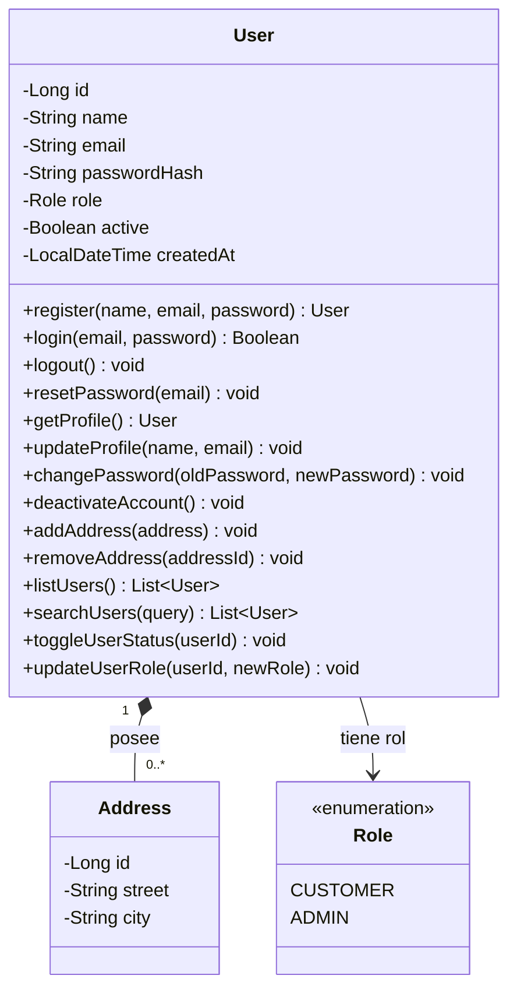

# Diagramas UML de clases — Pet Shop

Los siguientes diagramas están escritos en Mermaid y pueden visualizarse en GitHub, VS Code (con una extensión compatible) o [Mermaid Live Editor](https://mermaid.live/).

## 1. Product, Category y StockMovement

## 2. Order, OrderItem, ShippingAddress y OrderStatus

## 3. Payment y PaymentMethod

## 4. User, Address y Role

## Notas

- `*--` representa una relación de composición: un objeto contiene otros objetos que forman parte de él.
- `-->` representa una asociación dirigida entre clases.
- `1` significa exactamente uno.
- `0..*` significa cero o muchos.
- `1..*` significa uno o muchos.
- Las enumeraciones representan un conjunto definido de valores posibles.
- Los tipos y las firmas de los métodos se han transcrito a partir del diagrama de referencia y conviene contrastarlos con el código fuente del proyecto.
